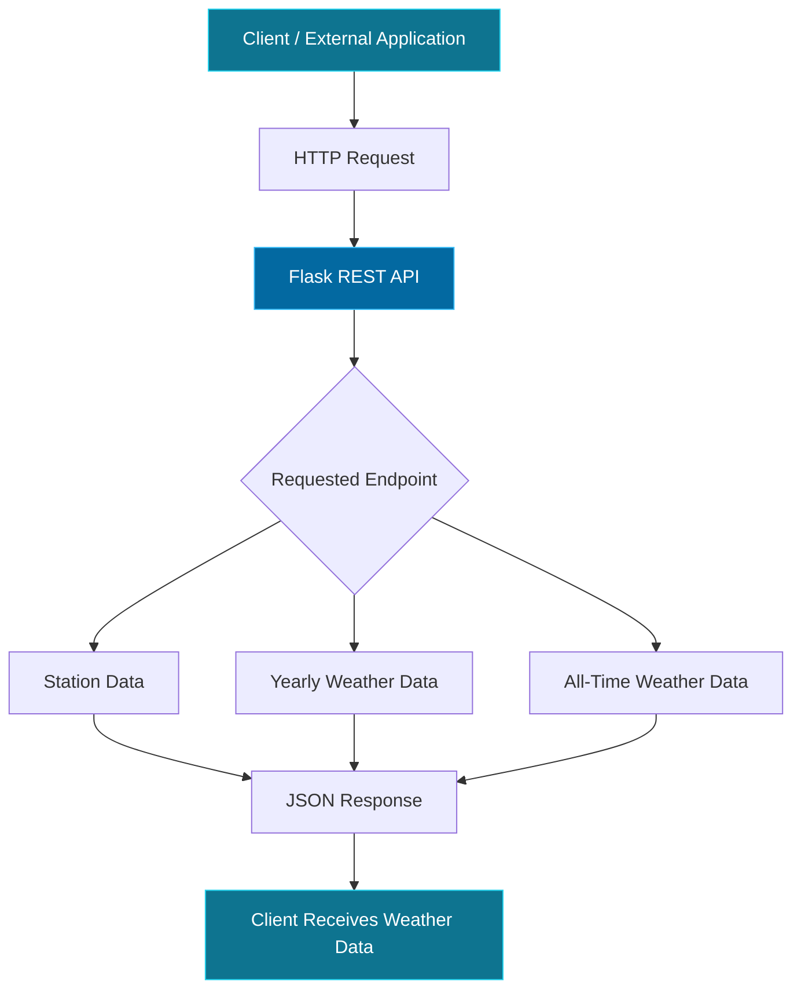

<div align="center">

# 🌦️ Weather API

### Weather data. Structured. Accessible. Ready to use.

A Python and Flask-based REST API providing access to weather data collected from multiple weather stations across Europe.

<br/>


<br/>

**Weather Data · RESTful Endpoints · Station-Based Retrieval**

</div>

---

## 📡 Overview

Weather API is a RESTful API built using Python and Flask that provides structured access to weather data from multiple weather stations across Europe.

The application organises weather information by station, allowing users and external applications to retrieve relevant weather records through dedicated API endpoints.

It also supports historical data retrieval through additional endpoints, making it possible to access yearly and all-time weather records.

Designed with simplicity and accessibility in mind, the API provides a straightforward way to retrieve and integrate weather station data into other applications.

## ✨ Features

- **Multiple Weather Stations:** Access weather data from different monitoring stations across Europe.
- **Station-Based Retrieval:** Fetch weather records using individual station identifiers.
- **Historical Data:** Retrieve yearly and all-time weather records through dedicated endpoints.
- **RESTful Architecture:** Exposes structured endpoints for easy integration with external applications.
- **JSON Responses:** Returns weather information in a structured format.
- **Lightweight Backend:** Developed using Flask for a simple and efficient API architecture.

---

## 🏗️ API Architecture

The application follows a simple client-server architecture.



### Request Lifecycle

1. A client sends an HTTP request to the API.
2. Flask receives the request and identifies the requested endpoint.
3. The application retrieves the corresponding weather station data.
4. The requested information is processed and structured.
5. The API returns the result as a JSON response.

---

## 🔌 API Endpoints

The API provides multiple endpoints for retrieving weather station information.

| Endpoint | Description |
|:---|:---|
| `/` | Base endpoint of the application. |
| `/...` | Retrieve weather data for a specific station. |
| `/...` | Retrieve yearly weather records. |
| `/...` | Retrieve all-time weather records. |

> **Note:** Replace the placeholder routes above with the exact routes defined in `main.py` before publishing this README.

### Example API Request

Once the application is running locally, you can access an endpoint using your browser, Postman or `curl`.

```bash
curl http://127.0.0.1:5000/
```

For endpoints that return weather station information, the API responds with JSON data.

Example response format:

```json
{
    "station_id": "example_station",
    "temperature": 18.5,
    "date": "2026-10-15"
}
```

*Illustrative response structure. Actual field names and values depend on the implemented endpoint.*

---

## 🛠️ Tech Stack

| Technology | Purpose |
|:---|:---|
| Python | Core application logic |
| Flask | REST API development and routing |
| JSON | Structured API responses |
| HTML / CSS | Frontend presentation |
| Weather Station Data | Source of weather records |

---

## 📂 Project Structure

```text
weatherapi_app4/
│
├── data_small/
│   └── ...                 # Weather station data
│
├── static/
│   └── ...                 # Static assets
│
├── templates/
│   └── ...                 # HTML templates
│
├── main.py                 # Flask application and API routes
│
├── .gitignore
└── README.md
```

### File Descriptions

| File / Directory | Description |
|:---|:---|
| `main.py` | Main Flask application containing the API routes and backend logic. |
| `data_small/` | Contains the weather station data used by the application. |
| `static/` | Stores static frontend resources such as stylesheets and assets. |
| `templates/` | Contains HTML templates used for rendering web pages. |
| `.gitignore` | Specifies files excluded from version control. |

---

## 🚀 Getting Started

Follow the steps below to clone and run the API locally.

### 1. Prerequisites

Make sure you have:

- Python 3.x installed.
- Git installed.
- A terminal or command-line interface.

### 2. Clone the Repository

```bash
git clone https://github.com/Conformitty/weatherapi_app4.git
```

Navigate into the project directory:

```bash
cd weatherapi_app4
```

### 3. Create a Virtual Environment

A virtual environment keeps the project's dependencies isolated.

**Windows:**

```bash
python -m venv venv
venv\Scripts\activate
```

**macOS / Linux:**

```bash
python3 -m venv venv
source venv/bin/activate
```

### 4. Install Dependencies

Install Flask and any other required packages:

```bash
pip install flask
```

If a `requirements.txt` file is added to the repository, use:

```bash
pip install -r requirements.txt
```

### 5. Run the Application

Start the Flask development server:

```bash
python main.py
```

The application should now be accessible at:

```text
http://127.0.0.1:5000/
```

You can interact with the available API endpoints using your browser, Postman or any HTTP client.

---

## 🧪 Testing the API

You can test the API using tools such as:

- **Postman:** Send HTTP requests and inspect JSON responses.
- **cURL:** Test endpoints directly from the terminal.
- **Web Browser:** Access endpoints that support GET requests.

Example:

```bash
curl -i http://127.0.0.1:5000/
```

Check the HTTP response status and returned JSON data to verify that the endpoint is functioning correctly.

---

## 🔭 Potential Improvements

- Integration with live weather data sources.
- Additional filtering by station, date and location.
- Extended weather metrics and analytics.
- Improved API documentation using Swagger / OpenAPI.
- Caching for frequently requested weather records.
- Deployment to a cloud hosting platform.

---

## 🤝 Contributing

Contributions, suggestions and improvements are welcome!

1. Fork the repository.
2. Create a new feature branch.
3. Commit your changes.
4. Push the branch to your fork.
5. Open a Pull Request.

---

<div align="center">

### 🌍 Making Weather Data More Accessible.

**Built with Python & Flask**

[](https://github.com/Conformitty)

</div>
